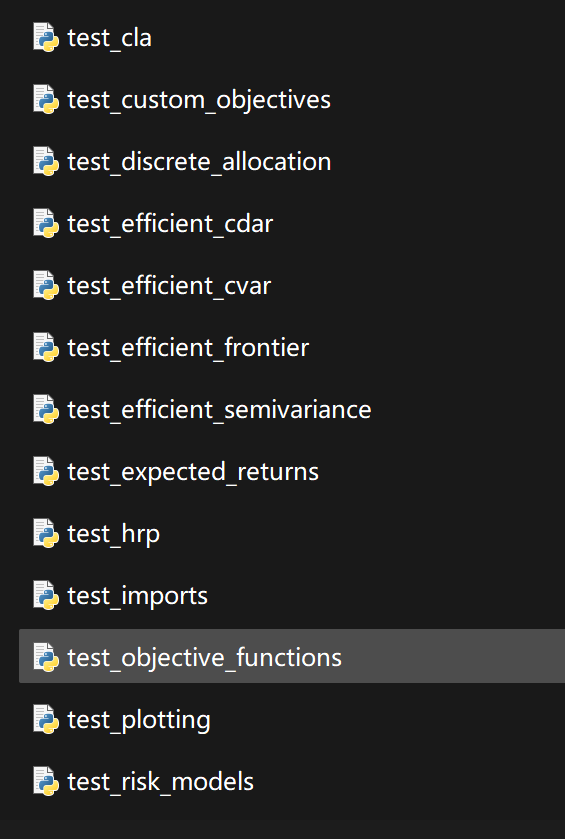

# Portfolio Optimization (Python Code Implementation)

A repository for portfolio optimization methods, including classic mean-variance optimization techniques and the Black-Litterman asset allocation model, as well as recent advancements in the field such as Sharpe ratio shrinkage and hierarchical risk-parity models.

## Images

<!-- PAYMENT_BLOCK -->

## Get this dataset

- Payment link (Stripe): [Buy now](https://buy.stripe.com/3cs8yP7sY87d0vu9AB)
- Payment QR code: 

<!-- /PAYMENT_BLOCK -->
